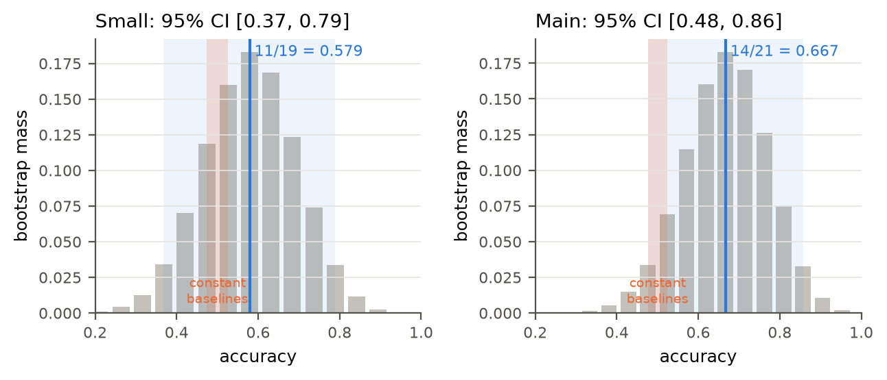
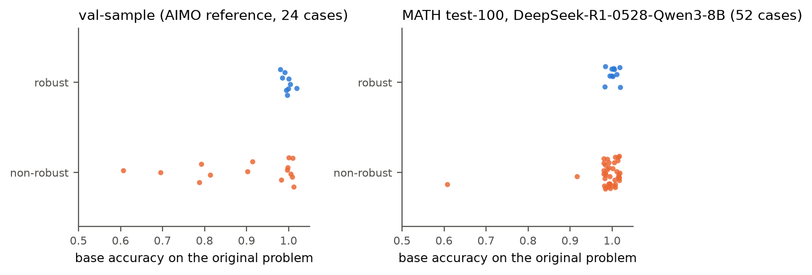
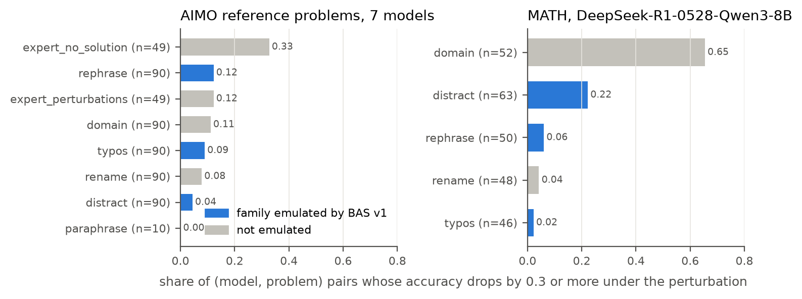
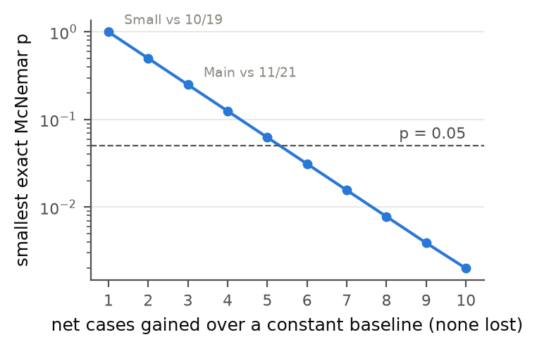
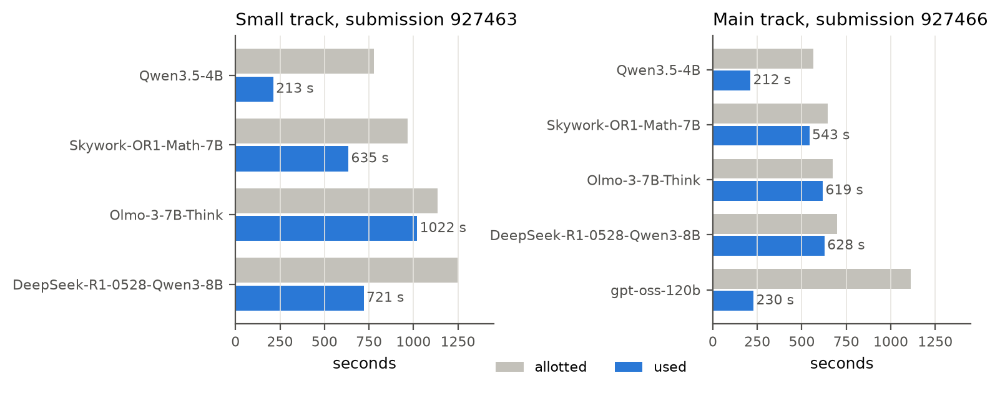
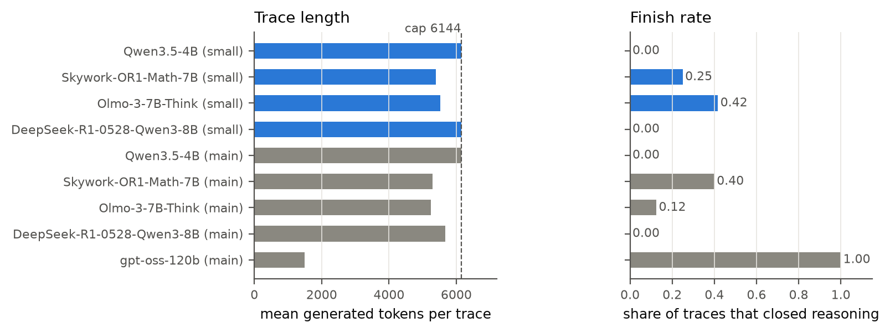

# Budgeted Answer Stability: a label-free, compute-bounded robustness probe for reasoning models, and a negative result

Christos Vasilopoulos, independent researcher, Greece.

Technical report for the AIMO Interpretability Challenge (NeurIPS 2026 competition track), submission version of 2026-10-24. Code, all scored bundles, logs and data: https://github.com/CVasilopoulos/aimo-bas, branch `report-submission` (code and bundles as of commit `ebd30c5`; later commits change only the report). MIT licence.

Every number in this report is read from a file in that repository; the file is cited next to the number. Section 7 gives the command that regenerates each file and states what was re-run from a fresh clone on 2026-10-24.

## Abstract

**Contribution.** Budgeted Answer Stability (BAS) asks a model each problem several times, in its original form and in prose-only perturbations, under a fixed thinking budget; forces an answer at the cut (the *answer-commitment probe*, our one white-box readout: the forced answer and its token probability); and ranks problems by answer agreement, completion and confidence. It has no trained parameters, needs no labels, runs unchanged on all five competition models within 3600 s of one GPU, and used 62 to 72 percent of that budget, 46 to 180 s per problem per model. We release the code, all 14 uploaded bundles with their hashes and scores, and the tooling that regenerates every table.

**Negative result.** No BAS result is distinguishable from a constant predictor. The v7 scores (0.579 on Small, 11/19; 0.667 on Main, 14/21) have 95 percent intervals that contain the constant baselines; on the v8 sets the same bundles scored 6/14 and 13/21, and four of six budget profiles tie constant `True` on Main. On 52 labelled public MATH cases every feature's AUC interval contains 0.5. A dedicated ablation of the white-box readout moves no AUC resolvably (−0.05, 95% CI −0.15 to +0.04); it changes the decision rule's accuracy (0.538 with it, 0.346 without, exact McNemar p = 0.021) only through the rule's positive rate, and both stay below always-`True` (0.692). The labels explain why: base-problem self-consistency reproduces two thirds of the public AIMO labels but fails where base accuracy saturates, and most label-driving perturbations (removed premises, domain transfer) are out of reach of prose edits. On 14 to 21 hidden cases, p < 0.05 needs a six-case lead over a constant baseline, which no method can reach on the 14-case v8 Small set.

## Submission at a glance

| Item | Value |
|---|---|
| Primary bundles | `submissions/aimo-bas-v1-main.zip` (SHA-256 `463729c8a5367f16791057b036a467b02a17b865fd1300dd75d7bbab207b588c`), `submissions/aimo-bas-v1-small.zip` (`685584fed46bd6ec3279169f41eb55899432b8c427f099ae400c9fe0f396bf20`) |
| Scores | v7: Main 14/21 (927466), Small 11/19 (927463); v8: Main 13/21 (941828), Small 6/14 (941825), both matched by a rebuild with the same settings (948991, 949033) (`submissions.csv`, `submissions_v8.csv`) |
| Other uploads | 12 profile-sweep bundles, all in `submissions/` with hashes and scores (Table 2, Appendix I) |
| Training data, training code | none: BAS has no trained parameters (Section 7.1) |
| Dependencies at evaluation | the five competition models by id from the organisers' offline cache and the Python packages of the organisers' runtime image (`torch`, `transformers`, `accelerate`); nothing else |
| Reproduce a score | upload the bundle unchanged to the matching Codabench task |
| Check the bundles | `python3 tools/verify_bundles.py` (hash, byte-identical rebuild, diff against `solution/`) |

## 1 Introduction

Benchmark accuracy on olympiad problems does not say whether a model's success is stable (Mirzadeh et al., 2025; Mondorf et al., 2026). The AIMO Interpretability Challenge (Štefánik et al., 2026) makes this a binary audit: given a model and a problem it answers correctly, predict whether the answer holds under a hidden set of perturbations. Submissions run offline on the organisers' hardware: an auditor with a fixed GPU budget, the model weights and no labels. BAS takes the cheapest route that uses the model itself as the instrument: it asks the original question a few times and in lightly perturbed forms, stops every trace at a fixed token budget, and forces the model to state the answer it is converging on.

Contributions:

1. **A measured negative result.** Neither BAS nor any of its features separates robust from non-robust cases on the data we can label, and none of its leaderboard scores is distinguishable from a constant predictor (Sections 4.1 and 4.4). A dedicated ablation shows that its white-box readout does not improve the ranking (Section 4.5).
2. **An account of why.** Base-problem self-consistency reproduces two thirds of the public AIMO labels; the residual is unsolvability detection, and on MATH the labels are driven by domain transfer that prose edits do not reach (Section 4.4).
3. **What 14 to 21 hidden cases can resolve**, applied to a six-profile leaderboard sweep: a six-case lead over a constant is the minimum for p < 0.05, and the 14-case v8 Small set cannot show one (Sections 4.1 and 4.6).
4. **BAS itself**, a budget-aware, label-free, training-free probe that runs unchanged on any open-weights reasoning model with a chat template, with the answer-commitment probe as a cheap readout of the answer a truncated trace has committed to, and its runtime profile on the competition hardware (Sections 3 and 4.2).

## 2 Task, data and constraints

**Interface.** The ingestion program calls `are_robust(model_id, problems)` once per model and expects a Python `list` of `bool` of the same length; anything else invalidates the whole model batch. There are no case ids, answers or labels. All models and problems share 3600 s on one RTX PRO 6000 (96 GB, shared with other jobs), with a read-only Hugging Face cache and `HF_HUB_OFFLINE=1`.

**Models.** Main track: `Qwen/Qwen3.5-4B`, `Skywork/Skywork-OR1-Math-7B`, `allenai/Olmo-3-7B-Think`, `deepseek-ai/DeepSeek-R1-0528-Qwen3-8B`, `openai/gpt-oss-120b`. The Small Models track omits gpt-oss-120b.

**Labels.** A case is robust when the model's accuracy holds under every perturbation the organisers apply (rephrase, rename, domain, distract, typos, expert perturbations, expert no-solution) and non-robust when at least one clearly degrades it; the exact criterion is unpublished and only clear-cut cases are kept (competition FAQ 7). The organisers sample labels at temperature 1.0, top-k 40 and top-p 0.95 with up to 100,000 tokens (FAQ, published 2026-09-21, after our v1 design).

**Public data, for analysis only.** We trained nothing. We analyse `aimo-interp/val-sample` (24 (model, problem) cases on 8 public AIMO 2025 reference problems, 9 robust), `augmented-sample-math-agg` (137 MATH cases, alias `qwen3-8b:low`, 36 robust) with its DeepSeek-labelled `-agg-filtered` subset, the per-perturbation `augmented-sample-math-full-filtered` set and the unlabelled `aimo-interp-challenge-sample-full` set (7 models, per-perturbation decay statistics); revisions are in Section 7.4, sizes in Appendix E. The 54 test rows of the `qwen3-8b:low` aggregate match that subset exactly (`dataset_alias_check.csv`), so we treat `qwen3-8b:low` as DeepSeek-R1-0528-Qwen3-8B, the only competition model with substantial public labels.

**Hidden sets and their replacement.** Our two scored v7 runs were on the v7 tasks (Main 35766, Small 35767), whose exact sizes the `n` fields of our logs give: Small 19 cases (3, 6, 6, 4 per model), Main 21 (3, 5, 4, 4, 5) (`runtime_totals.csv`). On 2026-09-16, after our uploads, the organisers replaced both tasks with v8 versions (Main 36237, Small 36241; `competition_tasks.csv`); our v7 entries are no longer listed. On 2026-09-23, 16 of 32 Small entries scored 0.64 (= 9/14) and 9 of 18 Main entries 0.62 (= 13/21), consistent with 14 and 21 cases and with constant `True` predictors if 9 and 13 cases are robust (`leaderboard_snapshots.csv`). The final ranking uses another, unpublished set.

## 3 Method

### 3.1 Overview

BAS samples each problem and its perturbations under a thinking budget (3.2, 3.3), forces an answer from every trace (3.4) and labels the top half of each model batch robust (3.5). Settings are in `hyperparameters.csv`; the v1 bundles use the `gpu` profile.

### 3.2 Perturbations without symbolic chains

The organisers generate their perturbations from symbolic solution chains, which a submission does not have. We use only deterministic edits that cannot change the answer: they touch prose only, never math spans or digits, and are seeded by SHA-256 of the problem text. `typos` swaps adjacent letters in two prose words, `distract` appends an explicitly unrelated, number-free sentence, and `rephrase` swaps the lead verb and adds a neutral frame; `rename` applies to 1 of the 8 public problems and is unused in v1. Our `distract` is visibly weaker than the organisers': theirs inserts a plausible mathematical aside inside the statement, ours appends an obviously irrelevant note (Appendix B).

### 3.3 Prompts and budgeted sampling

Each variant uses the model's own chat template with thinking enabled and the organisers' solve prompt verbatim; gpt-oss uses the harmony template with `reasoning_effort=low` (Appendix A). A batch of `n <= 8` problems gets three originals plus `typos`, `distract` and `rephrase` (6 sequences per problem); `n <= 16`, two originals plus `typos` and `distract`; larger batches, the original plus `distract`. Every scored batch had 3 to 6 problems. Generation stops at `max_new_tokens` 6144 or when a `StoppingCriteria` ends the whole chunk at a wall-clock deadline; sampling settings are in Appendix A.

### 3.4 Answer-commitment probe

Reasoning models answer after a closing marker (`</think>`, or the end of the harmony analysis channel), so a budget-stopped trace has none. We cut the text at the marker or, failing that, at the truncation point, append a forced suffix (`\n</think>\n\nANSWER: ` or its harmony equivalent; Appendix A) and greedily decode at most 12 tokens up to the first newline. The normalised answer is the commitment, and the mean top-1 probability of its tokens is its *confidence*. Finished traces get the same pass but keep their natural answer, taking only the confidence. The readout is the answer the model is converging on at the cut and how sharply, in the spirit of budget forcing (Muennighoff et al., 2025) and trace-uncertainty features (Grünefeld et al., 2026), at a cost of one short greedy decode per sequence: 68 to 92 s per run (`runtime_totals.csv`).

This is the only place where BAS reads model internals: an intervention on the input (closing the reasoning early) and the output token probabilities of the forced continuation. It reads no hidden states, weights or gradients. Section 4.5 ablates it.

### 3.5 Features and decision rule

Over a problem's sequences, `agree` is the share whose answer equals the modal non-empty answer, `finish` the share whose reasoning closed within the budget, and `confidence` the mean commitment confidence, a token-probability self-assessment in the spirit of Kadavath et al. (2022). Score = 0.5·agree + 0.3·finish + 0.2·confidence. Within a model batch, the top `floor(n/2)` problems by score are predicted robust (ties broken by shorter text; one more when `n` is odd and the middle score is at least 0.5). Scores of at least 0.9 are always robust and scores of at most 0.3 always non-robust. The rule is rank-based because no labels exist to calibrate a threshold for these models and the public labels are roughly balanced. Two auxiliary features, `stable` (share of *perturbed* sequences that agree with the modal answer) and `orig_agree`, are computed but unused in v1. The weights and thresholds were set by hand, informed by the public val-sample analysis of Section 4.4; nothing was fitted.

### 3.6 Budget control, memory and failure handling

Each model gets a weighted share of the time left after a 480 s safety margin (weight 1.5 for gpt-oss-120b, 1 otherwise), and unused time flows to later models (Appendix F); the chunk size follows a per-sequence KV-cache estimate (Appendix C). If less than 45 s remain for a model, or on any exception, the batch falls back to a length prior (problems not longer than the batch median are robust), so the output is always valid.

## 4 Experiments

### 4.1 Leaderboard results

Table 1 (`leaderboard_stats.csv`, `submissions.csv`): 100,000 bootstrap resamples of the per-case 0/1 outcomes (percentile interval, seed 20261101; Efron and Tibshirani, 1993), with Wilson (1927) and Clopper-Pearson (1934) intervals as a check. "Constant" is the accuracy of `always True`/`always False` under balanced labels, which the warm-up phase suggests (17 cases, constant baselines at 0.47 and 0.53). The v8 sets are not balanced: their score clusters imply 13 of 21 and 9 of 14 robust cases (Section 2).

| Track | Submission | Correct | Accuracy | 95% bootstrap CI | Wilson | Clopper-Pearson | Binomial p vs 0.5 | Constant baselines |
|---|---|---|---|---|---|---|---|---|
| Small (v7, 19 cases) | 927463 | 11 | 0.579 | 0.368 to 0.789 | 0.363 to 0.769 | 0.335 to 0.797 | 0.648 | 0.474 / 0.526 |
| Main (v7, 21 cases) | 927466 | 14 | 0.667 | 0.476 to 0.857 | 0.454 to 0.828 | 0.430 to 0.854 | 0.189 | 0.476 / 0.524 |

*Table 1. The two v7 runs of the v1 bundles.*



*Figure 1. Bootstrap distribution of each scored run's accuracy (`leaderboard_stats.csv`): observed score (blue line), 95 percent interval (blue band), constant baselines under balanced labels (orange band). One case is 0.053 (Small) or 0.048 (Main) of accuracy.*

Neither score is distinguishable from chance by a binomial test, and the intervals contain both constant baselines. Under a permutation null in which the method's ranking is random but its positive count is fixed (10 of 19 and 12 of 21 predicted robust; `runtime_totals.csv`), the probability of scoring at least as well is 0.41 for Small and 0.14 for Main when the hidden labels are balanced (`permutation_null.csv`).

**v8 sets and a profile sweep on the leaderboard.** After the replacement, the unchanged v1 bundles were re-uploaded, and a nightly runner uploaded five variants that change only the thinking budget, the variant plan or the safety margin, plus a rebuild of the v1 settings (Table 2; `submissions_v8.csv`, which records each upload's ids, bundle hash and score from the Codabench listing `submissions/logs/codabench_own_submissions_2026-10-02.txt`).

| Profile | Thinking tokens | Sequences per problem (n <= 8) | Main v8 (21 cases) | Small v8 (14 cases) |
|---|---|---|---|---|
| `gpu` (v1 bundles) | 6144 | 6: three originals, typos, distract, rephrase | 13 (941828) | 6 (941825) |
| `gpu` (rebuild) | 6144 | 6, as v1 | 13 (948991) | 6 (949033) |
| `gpu-long` | 10240 | 6, as v1; safety margin 420 s | 11 (943943) | 5 (943987) |
| `gpu-fast` | 3072 | 4: two originals, typos, distract | 12 (942805) | 6 (942816) |
| `gpu-fast-tight` | 3072 | 4, as `gpu-fast`; safety margin 300 s | 13 (954334) | run failed (954349) |
| `gpu-faster` | 2048 | 4, as `gpu-fast` | 13 (950733) | 9 (950748) |
| `gpu-fast-wide` | 3072 | 5: two originals, typos, distract, rephrase | 13 (952657) | 10 (952682) |
| constant `True` (inferred from the score clusters) | - | - | 13 | 9 |

*Table 2. Correct cases on the v8 hidden sets; the Codabench id of the scored row in brackets.*

On Main, four of the six profiles (five of the seven uploads) score exactly what a constant `True` predictor reaches (13 of 21). On Small, scores spread from 5 to 10 of 14 around the constant's 9, and the best profile leads by one case. The longest thinking budget is the worst on both tracks: at this scale, more reasoning tokens did not buy a better robustness signal. The v1 settings reproduced their score exactly on a second upload, but `gpu-fast` and `gpu-fast-tight`, differing only in the safety margin, differ by one case on Main: wall-clock truncation on a shared GPU can move a case. None of these differences is resolvable (Section 4.6): the largest is five cases on 14, and the smallest exact McNemar p-value a five-case lead can reach is 0.0625.

### 4.2 Runtime and budget use

Per-model figures are in Table 5 and Figures 2 and 3 (Appendix G; `runtime_per_model.csv`).

- The Small run used 2591 s (72 percent of 3600) and the Main run 2232 s (62 percent; `runtime_totals.csv`); the 480 s safety margin was never touched.
- The thinking cap, not the wall clock, was binding for the small models: Qwen3.5-4B and DeepSeek-R1-0528-Qwen3-8B (Small) produced exactly 6144 tokens in all 18 and 24 traces and finished none. Olmo-3-7B-Think (both tracks) and DeepSeek (Main) were also cut by the wall clock; Skywork finished 25 to 40 percent of its traces. Throughput was 199 to 554 tokens per second (HF `generate`, no paged cache).
- gpt-oss-120b at low effort is the cheapest model: all 30 traces closed at a mean of 1489 tokens in 198 s, 21 percent of its allotment, so its 1.5 weight was misallocated. The Main run left 888 s unused beyond the margin, about 2,800 more tokens per trace for the 7B and 8B models; the Small run left 529 s, about 1,300 tokens (`extra_tokens_per_trace_affordable_7b_8b`).
- For the models that never finished a trace (Qwen3.5-4B and DeepSeek, on both tracks), `finish` was identically zero, so their score could not exceed 0.7, the 0.9 override never fired, and their decisions ranked forced answers on truncated reasoning by `0.5·agree + 0.2·confidence`.

### 4.3 Agreement under truncation

`agree` was high even where nothing finished: 0.889 and 0.778 for Qwen3.5-4B, 0.625 and 0.583 for DeepSeek, 0.944 and 0.875 for Olmo (Small, then Main; Table 5). These are agreement rates of *forced* answers across 6 truncated traces per problem, so for these models the ranking rests entirely on the commitment probe, whose agreement with finished answers on olympiad problems at 6144 tokens is unmeasured (Section 6).

### 4.4 Public-data analysis: difficulty versus perturbation sensitivity

**Base accuracy predicts most public AIMO labels.** On the 24 val-sample cases, all 9 robust cases have base accuracy 1.0 on 10 samples; of the 15 non-robust cases, 7 are below 1.0 and 8 at 1.0 (`val_sample_crosstab.csv`). The rule "robust iff base accuracy is 1.0" therefore scores 16/24 = 0.667, against 0.375 for always-true, 0.625 for always-false and 0.500 for the length prior (`proxy_rules.csv`). This made self-consistency (Wang et al., 2023) the backbone of BAS.



*Figure 4. Base accuracy on the original problem by label: public AIMO cases (left; `val_sample_cases.csv`) and public MATH cases of DeepSeek-R1-0528-Qwen3-8B (right; `math_deepseek_test_cases.csv`).*

**The residual is unsolvability detection.** Of the 8 val-sample cases that are non-robust despite base accuracy 1.0, 7 are labelled through `expert_no_solution` alone and 1 through `rename` alone (`val_sample_cases.csv`). Over all 15 non-robust cases, `expert_no_solution` appears in 10, `domain` and `rename` in 3 each, `rephrase` in 2 and `distract` in 1 (`label_families.csv`). Of these, 1 decayed only through BAS v1 families (`typos`, `distract`, `rephrase`), 2 through a mix and 12 only through other families, so even a perfect emulation of our three families could have flipped at most 3 of the 15 public negatives.

**Where base accuracy saturates, the proxy fails.** On the DeepSeek MATH test set (52 unique cases, 11 robust), base accuracy is 1.0 for 50 of 52 cases; the base-accuracy rule scores 13/52 = 0.250, below always-false (0.788), and the length prior 0.327 (`proxy_rules.csv`); on all 137 labelled DeepSeek MATH cases, 0.285, 0.737 and 0.358. These labels are driven by `domain` (82 of 101 non-robust cases) and `distract` (17), with `rephrase` (4) and `rename` (2) marginal; 81 of 101 negatives are outside the v1 families (`label_families.csv`).

**Which perturbation families move models.** Over 7 models on the AIMO reference problems, the organisers' decay data (Figure 5; `perturbation_decay.csv`) give these shares of (model, problem) pairs whose accuracy drops by at least 0.3: `expert_no_solution` 0.33, `rephrase` 0.12, `expert_perturbations` 0.12, `domain` 0.11, `typos` 0.09, `rename` 0.08, `distract` 0.04. For the DeepSeek alias (10 problems), only `expert_no_solution` causes such a drop (0.29; every other family 0.0). On MATH for the same model: `domain` 0.65, `distract` 0.22, `rephrase` 0.06, `rename` 0.04, `typos` 0.02.



*Figure 5. Share of (model, problem) pairs with an accuracy drop of at least 0.3 per perturbation family; blue marks the families BAS v1 emulates (`perturbation_decay.csv`).*

**BAS features on labelled public data.** We ran the BAS sampler on DeepSeek-R1-0528-Qwen3-8B over the first 52 rows of `augmented-sample-math-agg` on Kaggle (2 x T4). The kernel ran the steps now in `tools/kaggle_ablation.py`: `tools/ablate.py` in chunks of 13 cases, with a 7,000 s budget per chunk and a 3072-token cap (Section 7.3). The parquet lists robust rows first, so the sample holds all 36 robust cases and 16 of the 101 non-robust ones (69 percent robust, against 26 percent in the full set); it is not the 52-case test set above. Each problem had four sequences (two originals, `typos`, `distract`), and the wall-clock budget, not the 3072-token cap, ended most traces: median 1398 generated tokens, 43 of 208 traces closed (`runs/kaggle_ablate/deepseek-math-3072-full-n52.jsonl`).

| Feature | AUC for the robust label | 95% bootstrap CI | Top-k accuracy |
|---|---|---|---|
| `agree` (all sequences) | 0.521 | 0.37 to 0.68 | 0.615 |
| agreement on the originals only (difficulty) | 0.545 | 0.41 to 0.68 | 0.692 |
| agreement on the perturbed sequences only (sensitivity) | 0.531 | 0.40 to 0.67 | 0.654 |
| `confidence` | 0.601 | 0.44 to 0.75 | 0.538 |
| `finish` | 0.440 | 0.28 to 0.59 | 0.769 |
| BAS score (0.5 / 0.3 / 0.2) | 0.491 | 0.30 to 0.67 | 0.615 |
| shorter problem (fallback prior) | 0.373 | 0.18 to 0.57 | 0.577 |

*Table 3. Each feature as a ranking score for the robust label on the 52 cases; top-k accuracy labels the k = 36 highest-scoring cases robust. Bootstrap: 4000 resamples, seed 20261101 (`tools/report/ablation_tables.py`).*

No feature separates the two classes: every interval contains 0.5, and the BAS rank rule (0.538 with batch-relative halves) is below always-true (0.692) on this sample. Agreement on the originals and on the perturbed variants carries the same (absent) signal, so on these labels neither difficulty nor sensitivity is visible to a four-sample, roughly 1400-token probe. As the label analysis predicts, the MATH labels are driven by `domain` perturbations, which our prose edits do not emulate, and by the organisers' `distract`, which is much stronger than ours (Appendix B), and saturated base accuracy leaves self-consistency nothing to measure. The original-only and perturbed-only plans did not finish within Kaggle's 12-hour limit (26 original-only cases are in `deepseek-math-3072-orig-n52.jsonl` and are not analysed).

### 4.5 Dedicated ablation of the white-box readout

The answer-commitment probe enters the BAS score twice: the forced answer stands in for the missing answer of every unclosed trace in `agree`, and its token probability is `confidence`. We ablate both on the 52-case sample by replaying the logged per-sample answers through the submitted feature and decision code (`tools/report/whitebox_ablation.py`; the replay reproduces all 52 logged predictions). *No-confidence* drops `confidence` and rescales the other weights to 0.625/0.375 so that the 0.9 and 0.3 overrides keep their meaning; *no-probe* also removes the forced answers, so an unclosed trace has no answer, as BAS would see it without the probe; *confidence-only* ranks by the probe's probability alone.

| Variant | AUC (95% CI) | ΔAUC vs BAS (95% paired CI) | Rule accuracy | Decisions changed | Exact McNemar p vs BAS | Top-k accuracy |
|---|---|---|---|---|---|---|
| BAS as submitted | 0.491 (0.30 to 0.67) | - | 0.538 | - | - | 0.615 |
| no-confidence | 0.466 (0.28 to 0.65) | −0.025 (−0.07 to +0.02) | 0.462 | 10 | 0.34 | 0.615 |
| no-probe | 0.440 (0.28 to 0.59) | −0.051 (−0.15 to +0.04) | 0.346 | 16 | 0.021 | 0.769 |
| confidence-only | 0.601 (0.44 to 0.75) | +0.109 (−0.01 to +0.25) | 0.558 | 11 | 1.0 | 0.538 |

*Table 4. White-box ablation on the 52 labelled MATH cases (`whitebox_ablation.csv`); always-`True` scores 0.692. Paired bootstrap: 4000 resamples, seed 20261101.*

The ranking does not depend on the white-box readout: no ΔAUC interval excludes zero, and every AUC interval contains 0.5. The deployed rule does: without the probe, 13 decisions that BAS gets right turn wrong and 3 turn right (p = 0.021). The mechanism is calibration, not ranking. With 43 of 208 traces closed, most problems have no answer without the probe, their score falls to 0.3 or below and the always-non-robust override fires, so the rule predicts 12 positives instead of 28 on a sample that is 69 percent robust. At a fixed positive count (top-k) the probe-free score is better (0.769 against 0.615). The probability alone ranks best (0.601), but its interval contains 0.5.

We therefore make no claim to the White-Box Award: the probe's effect on accuracy is real on this sample, but it comes from where the rule's thresholds sit relative to the class balance, and neither variant beats a constant. On the scored v7 runs the probe decided every case of the models that closed no trace (Qwen3.5-4B and DeepSeek, 7 of 19 Small cases and 7 of 21 Main cases; `runtime_per_model.csv`); without per-case hidden outcomes its effect on those scores cannot be measured.

### 4.6 What 14 to 21 cases can resolve

An exact McNemar test (McNemar, 1947) depends only on the discordant counts `b` (cases BAS gets right and the baseline wrong) and `c`. With BAS at 11/19 and a constant baseline at 10/19, every feasible (b, c) gives p = 1.0; against 9/19 the minimum is 0.50. With BAS at 14/21, p ranges from 0.25 (b = 3, c = 0) to 0.63 against 11/21, and from 0.125 to 0.48 against 10/21 (`mcnemar_feasibility.csv`). The smallest p for a net lead of `d` cases with none lost is `2^(1-d)`, so p < 0.05 requires a lead of at least 6 cases (`mcnemar_minimum_lead.csv`, Figure 6): on v7, at least 16/19 or 17/21 if the constant baseline sits at 10/19 or 11/21. On v8 Small, if always-true scores 9/14 as the score cluster suggests, the maximum lead is 5 and the best attainable p is 0.0625, so no method can be shown to beat always-true there at the 5 percent level (`mcnemar_ceiling.csv`). On v8 Main (13/21 assumed) a lead of 8 is possible, p = 0.0078.



*Figure 6. Smallest exact McNemar p-value for a net lead of d cases over a constant baseline (`mcnemar_minimum_lead.csv`).*

The organisers' proposal announces bootstrap intervals and McNemar tests for the final report; on sets of this size those tests will separate only methods that differ by six or more cases.

## 5 Discussion

### 5.1 Where the signal comes from

On AIMO-level problems the public label is, to first order, "the model gets the original problem right every time". BAS measures this with `agree` and `finish`; its Main score of 14/21 is in line with the 16/24 of the base-accuracy rule on public cases, but distinguishable from neither that rule nor chance. What remains is largely failing to notice that a premise has been removed (`expert_no_solution`) and, on easier problems, failing to transfer the structure to another surface domain. Prose edits that keep the mathematics intact reach neither.

### 5.2 Negative results

1. **No BAS result is distinguishable from a constant predictor.** The v7 intervals contain both constant baselines (Table 1), the v8 profiles tie or trail constant `True` apart from a one-case lead on Small (Table 2), and on 52 labelled MATH cases every AUC interval contains 0.5, with the rank rule (0.538) below always-true (0.692; Table 3).
2. **The white-box readout does not improve the ranking.** Removing the forced answer and its probability changes no AUC resolvably; its effect on the rule's accuracy runs through the positive rate (Table 4). A readout of the answer a truncated trace has committed to is cheap, but on these labels it measures difficulty no better than the behaviour it replaces.
3. **The cheap-perturbation half of BAS targets the wrong families.** The three we emulate are among the weakest movers of AIMO-level models in the organisers' data, `distract` in particular (0.04 of pairs), and our `distract` is weaker still (Appendix B); at most 3 of 15 public negatives are attributable to them. Nor is there evidence that `stable` adds anything over `agree`: agreement on the perturbed sequences (AUC 0.531) carries no more signal than agreement on the originals (0.545; Table 3).
4. **6144 thinking tokens is too short for 7B and 8B thinking models on olympiad problems, and more did not help.** Two models finished no trace, so their decisions rested on forced answers at an arbitrary cut; the budget was guessed from KV memory and throughput without a GPU, and 28 to 38 percent of it went unused. Yet `gpu-long` (10240 tokens) scored lowest on both tracks (Table 2), though not resolvably.
5. **Base accuracy is not a difficulty proxy where it saturates** (1.0 for 50 of 52 DeepSeek MATH test cases, where the rule falls below always-false). Self-consistency needs problems near the model's frontier: the AIMO problems are, the public MATH problems are not.
6. **Static time weights were wrong.** gpt-oss-120b, weighted 1.5, needed a fifth of its allotment while the 7B and 8B models were cut; weights should follow the expected tokens per trace, which a run's first chunk can estimate.
7. **The length prior is not a safe fallback.** Its sign flips: robust problems are shorter on AIMO (median 189 against 321 characters) but longer on MATH (120.5 against 75; `problem_length_by_label.csv`).

### 5.3 Actionable use

The runtime profile is the useful artifact for practitioners. On one 96 GB card with plain HF `generate`, 6 traces of 6144 tokens for 3 to 6 problems cost 200 to 1000 s per 4B to 8B model, and the commitment readout 10 to 27 s per model. A red flag for "this model's committed answer to this problem is unstable" costs 46 to 180 s per problem per model (track medians 109 s and 138 s; `runtime_totals.csv`), without labels, symbolic chains or training. The negative results above say what that flag does not buy: on these labels it tracks neither a removed premise nor a change of domain, so an auditor who needs those must perturb the problem's structure, not its prose.

### 5.4 Evaluation design

Two observations for the organisers. With 10 submissions a day and 14 to 21 hidden cases, the leaderboard has a resolution of one case, and the final ranking will not be able to separate the top of the field by significance (Section 4.6). A larger final set, or per-model accuracies with intervals, would help. A mid-phase task replacement also silently retires every earlier entry; an announcement and a leaderboard note would help participants.

## 6 Limitations and future work

- Two scored v7 runs, a v8 sweep, a 52-case GPU ablation and no per-case hidden outcomes (the bundle logs no per-problem data, and Codabench reports only the aggregate): the claims about *why* BAS scores what it does rest on public data for other models (val-sample) and on one competition model on easier problems (MATH).
- The 52-case sample is 69 percent robust, ran at 3072 tokens on T4 GPUs with most traces cut by the wall clock, and holds only 16 negatives; the white-box ablation inherits all of this.
- Of the 7 models behind the public AIMO labels, only the `qwen3-8b:low` alias and possibly `gpt-oss-120b:low` are competition models; transfer to Qwen3.5-4B, Skywork and Olmo is an assumption.
- The commitment probe is validated only on a 0.6B proxy with easy problems (Appendix A).
- Answer normalisation is regex-based: the same answer in different forms counts as disagreement, which biases `agree` downward for models that box answers unusually.
- Our sampling (temperature 0.6, top-p 0.95) differs from the organisers' label-generation settings, published after our design.
- Sampling is seeded but not bit-reproducible across GPUs, and the v7 hidden sets are retired, so the v7 scores cannot be re-measured on the same data.

**Future work.** Not run (commands in Appendix H): BAS at 6144 tokens on all 137 labelled DeepSeek MATH cases, with original-only and perturbed-only plans; a thinking-budget curve on the same cases; a commitment curve that forces the answer at eight cuts from 512 to 10240 tokens; and score weightings beyond the single features of Table 3.

## 7 Reproducibility and transparency

### 7.1 Training data and training codebase

BAS has no trained parameters, so there is no training data and no training codebase. The bundles contain no artifacts. The constants in `hyperparameters.csv` (score weights, the 0.9 and 0.3 overrides, budgets, sampling settings) were set by hand, informed by the public val-sample analysis of Section 4.4 and by runtime estimates; no constant was fitted to labels. The v8 profile sweep used the hidden leaderboard as feedback; every upload is reported (Table 2), and the primary bundles are the v1 pair, which predates the sweep.

### 7.2 Submission bundles and their dependencies

All 14 uploaded bundles are in `submissions/` with their SHA-256, Codabench ids and scores in `submissions.csv` and `submissions_v8.csv` (Appendix I). `tools/build.py --name <name> --profile <profile>` builds a pair with fixed zip timestamps. `python3 tools/verify_bundles.py` checks each bundle against its manifest hash, rebuilds it from its own contents byte-identically, and compares every file with `solution/`: all code files are identical except `aimo_bas/profiles.py`, which in the released source carries three more profiles (`gpu-faster`, `gpu-fast-wide`, `gpu-fast-tight`) than the v1, `gpu-fast` and `gpu-long` bundles; the profiles those bundles use are unchanged. The sweep bundles built after 2026-09-27 also contain an inert backup, `aimo_bas/profiles.py.bak-2026-09-27`, identical to the v1 `profiles.py` and never imported.

At evaluation a bundle depends on: the five competition models, loaded by id from the organisers' offline cache with `local_files_only`; `torch` 2.12.1, `transformers` 5.13.0 and `accelerate` 1.13.0 (for `device_map="auto"`) from the organisers' runtime image `ghcr.io/aimo-interp/aimo-codabench-runtime:torch2.12.1-cuda13.2-cudnn9-transformers5.13.0-sklearn1.8.0-kernels0.15.2` (a bundled `requirements.txt` would be ignored; ours has none); and one GPU. It reads no other file and needs no network. The revision of each model in the organisers' cache is theirs; our local checks used the revisions in Section 7.4.

To reproduce a score, upload the bundle unchanged to the matching task (a Small bundle contains `small.txt`; `profile.txt` selects the profile, default `gpu`). On the v8 sets the v1 pair is expected to score 13/21 and 6/14, as it did and as a rebuild with the same settings did again; wall-clock truncation on a shared GPU can move a case (Section 4.1). The final ranking set is new, so its score is not known in advance.

### 7.3 Regenerating every number

| Numbers | Command | Output | Re-run from a fresh clone on 2026-10-24 |
|---|---|---|---|
| Bundle hashes, rebuilds, code identity | `python3 tools/verify_bundles.py` | stdout | yes: 14 of 14 pass |
| Unit tests | `python3 -m unittest tests/test_offline.py tests/test_report_tools.py` | stdout | yes: 16 pass |
| Inputs | `python3 tools/fetch_inputs.py`; `python3 research/getting-started/scripts/import_hf_dataset.py --dataset aimo-interp/val-sample --revision 1ae454ec1fad9727084eda8f9f3c9ae2239b21de --output-dir data/val-sample`; `uv run tools/make_cases.py research/hf/augmented-sample-math-agg.parquet data/math-deepseek` | `research/`, `data/` | yes: all SHA-256 match; val-sample cases identical to those used; the first 52 MATH case ids equal those of the GPU ablation |
| Tables 1, 5, Figures 1 to 6, Sections 2, 4.1 to 4.4, 4.6, Appendices B to G | `tools/report/run_all.sh` | `report/tables/*.csv`, `report/figures/*.png` | yes: every table byte-identical; figures pixel-identical except 91 pixels of Figure 6 one intensity level apart (PNG bytes differ) |
| Table 2 | `submissions_v8.csv`, from the Codabench listing in `submissions/logs/` | | n/a (Codabench data) |
| Table 3 | `python3 tools/report/ablation_tables.py runs/kaggle_ablate/deepseek-math-3072-full-n52.jsonl` | stdout | yes: identical |
| Table 4 | `python3 tools/report/whitebox_ablation.py` | `whitebox_ablation.csv` | yes: identical |
| GPU ablation output | `python3 tools/kaggle_ablation.py --plans full` (Kaggle, 2 x Tesla T4, torch 2.11.0+cu128, transformers 5.13.0, model revision `6e8885a6ff5c1dc5201574c8fd700323f23c25fa`) | `runs/kaggle_ablate/*.jsonl` | no (needs a GPU; about 7,000 s per 13 cases); the driver was smoke-run on CPU with a 0.6B proxy |
| Local contract test | `tools/fetch_probe_models.sh`; `MEMORY=6g CPUS=6 tools/run_local.sh submissions/aimo-bas-v1-small.zip data/smoke-qwen small` (and `main`) in the runtime image with `--network none` | `runs/<stamp>/` | yes: coverage 1.0, 0 invalid, about 125 s each; predictions byte-identical to the 2026-09-16 run |
| Leaderboard scores | upload to Codabench | | no (organisers' hidden sets) |

The fresh-clone check ran on a Linux host without a GPU, Python 3.12, in containers capped at 6 GB and 6 CPUs.

### 7.4 Resources and versions

| Resource | Version |
|---|---|
| `aimo-interp/val-sample` | `1ae454ec1fad9727084eda8f9f3c9ae2239b21de` |
| `aimo-interp/augmented-sample-math-agg` | `f972ced0705096f8d7ca7fac30825900b8b7fb6a` |
| `aimo-interp/augmented-sample-math-agg-filtered` | `0607cd06cbd789dd33655ff718bbfae0d3edba7c` |
| `aimo-interp/augmented-sample-math-full-filtered` | `f09e41ed0648b0ff7cac220c6ce9150a36e2e8b0` |
| `aimo-interp/aimo-interp-challenge-sample-full` | `c0ffb7e678294cc8819d50d979ba28ba49bd02d0` |
| `aimo-interp/getting-started` (ingestion, scoring, dataset import) | `995f9923a680a157c9239e08e4ef0fa0fa53bb58` |
| `aimo-interp/baselines` (solve prompt) | `7e8839966750059b6b1d247a12ab56552c79b342` |
| Model configs read by the report (`models.csv`) | Qwen3.5-4B `851bf6e8`, Skywork-OR1-Math-7B `fcef970f`, Olmo-3-7B-Think `d97e442d`, DeepSeek-R1-0528-Qwen3-8B `6e8885a6`, gpt-oss-120b `b5c939de` (full hashes in `tools/fetch_inputs.py`) |
| Probe models of the local contract test | Qwen3.5-0.8B `2fc06364715b967f1860aea9cf38778875588b17`, Qwen3-0.6B `c1899de289a04d12100db370d81485cdf75e47ca` |
| Runtime image | `ghcr.io/aimo-interp/aimo-codabench-runtime:torch2.12.1-cuda13.2-cudnn9-transformers5.13.0-sklearn1.8.0-kernels0.15.2` |
| Report scripts | Python 3.12 with `uv`; dependencies declared inline (`pandas>=2.2`, `pyarrow>=17`, `matplotlib>=3.9`, `numpy>=2`); the fresh-clone run resolved Python 3.12.15, pandas 3.1.0, pyarrow 26.0.0, matplotlib 3.11.2, numpy 2.5.4 with uv 0.9.5 |
| Competition hardware | one RTX PRO 6000, 96 GB, shared (organisers) |

`tools/fetch_inputs.py` downloads each dataset file and model config at these revisions and checks its SHA-256; the organisers' datasets are not redistributed in the repository.

## References

- Štefánik, M., Mondorf, P., Waldis, A., Liu, Q., Yang, C., Spiegel, M., Kuchař, J., Kadlčík, M., Vawda-Oomerjee, A., Liu, C., Frieder, S., Plank, B., Barez, F., Stenetorp, P. (2026). AIMO Interpretability Challenge. arXiv:2607.13899.
- Grünefeld, N., Højer, B., Mondorf, P., Plank, B., Rogers, A., Hardmeier, C., Heinrich, S., Frellsen, J. (2026). Tracing uncertainty in language model "reasoning". arXiv:2605.07776.
- Mirzadeh, S. I., Alizadeh, K., Shahrokhi, H., Tuzel, O., Bengio, S., Farajtabar, M. (2025). GSM-Symbolic: understanding the limitations of mathematical reasoning in large language models. ICLR 2025. arXiv:2410.05229.
- Mondorf, P., Bell, S. J., Dodge, J., Hupkes, D. (2026). LPDS: evaluating LLM robustness through logic-preserving difficulty scaling. arXiv:2605.15393.
- Wang, X., Wei, J., Schuurmans, D., Le, Q., Chi, E., Narang, S., Chowdhery, A., Zhou, D. (2023). Self-consistency improves chain of thought reasoning in language models. ICLR 2023. arXiv:2203.11171.
- Muennighoff, N., Yang, Z., Shi, W., Li, X. L., Fei-Fei, L., Hajishirzi, H., Zettlemoyer, L., Liang, P., Candès, E., Hashimoto, T. (2025). s1: simple test-time scaling. arXiv:2501.19393.
- Kadavath, S., et al. (2022). Language models (mostly) know what they know. arXiv:2207.05221.
- McNemar, Q. (1947). Note on the sampling error of the difference between correlated proportions or percentages. Psychometrika 12(2), 153–157.
- Efron, B., Tibshirani, R. J. (1993). An Introduction to the Bootstrap. Chapman and Hall.
- Wilson, E. B. (1927). Probable inference, the law of succession, and statistical inference. JASA 22(158), 209–212.
- Clopper, C. J., Pearson, E. S. (1934). The use of confidence or fiducial limits illustrated in the case of the binomial. Biometrika 26(4), 404–413.
- aimo-interp/getting-started and aimo-interp/baselines, GitHub (commits in Section 7.4); datasets under https://huggingface.co/aimo-interp.

## Appendix A: prompts, sampling and the commitment probe

See `report/tables/prompts.md` (generated from `engine.py`). The system prompt is the organisers' solve prompt; `prompts.md` confirms byte equality with `baselines/prompts/solve.txt`. The forced-answer suffixes are `\n</think>\n\nANSWER: ` and `<|end|><|start|>assistant<|channel|>final<|message|>ANSWER: `. Answer normalisation (`answers.py`) removes `\boxed`, `$`, thousands separators and markup, canonicalises integers, and maps NaN and "no solution" to `NaN`.

Sampling uses temperature 0.6 and top-p 0.95 (gpt-oss: 1.0 and 1.0), `max_new_tokens` 6144 and seed 20261101 plus the chunk offset.

Proxy check of the commitment probe: on Qwen3-0.6B, with two easy problems, five variants each and a 700-token budget, the forced answers matched the natural answers (28 and 2) with confidence about 1.0, and truncated traces still committed to the right answer (`tools/debug_probe.py`).

## Appendix B: perturbation examples and footprint

The edits (`solution/aimo_bas/perturb.py`) never touch `$...$`, `\(...\)`, `\[...\]`, LaTeX environments or digits. `typos` gives two distinct prose words of six or more letters one adjacent-letter swap each, in all their occurrences; `distract` appends a number-free, explicitly unrelated sentence after a blank line; `rephrase` swaps the lead verb (Find/Determine, Compute/Calculate, "What is"/Determine, "How many"/"Determine how many") and wraps the problem in a neutral frame ("Here is a competition problem." ... "Solve it carefully."); `rename` applies a person-name map (Alice, Bob, ... to Irene, Mateo, ...).

All four BAS variants of public problem `a1d40b` and the organisers' `distract` variant of the same problem are in `report/tables/perturbation_examples.md`. Footprint over the 8 public problems (`perturbation_footprint.csv`): `typos` changes 2.6 words and adds none; `distract` adds 21 words (118 characters); `rephrase` changes 2.1 and adds 7.4; `rename` applies to 1 problem. Math spans and digits are preserved in all 32 variants.

## Appendix C: models and KV-cache estimate

From the model configs (`models.csv`), estimate at a 6500-token sequence in bf16, with full, sliding-window and linear-attention layers handled separately. The generation chunk is the number of sequences that fit a 48 GB ceiling, capped at 48; an out-of-memory error halves the chunk and retries.

| Model | Layers | Heads / KV heads | Head dim | Full / sliding / linear layers | KV GB per sequence | Sequences per 48 GB chunk |
|---|---|---|---|---|---|---|
| Qwen3.5-4B | 32 | 16 / 4 | 256 | 8 / 0 / 24 | 0.386 | 48 (cap) |
| Skywork-OR1-Math-7B | 28 | 28 / 4 | 128 | 28 / 0 / 0 | 0.347 | 48 (cap) |
| Olmo-3-7B-Think | 32 | 32 / 32 | 128 | 8 / 24 / 0 (window 4096) | 2.293 | 20 |
| DeepSeek-R1-0528-Qwen3-8B | 36 | 32 / 8 | 128 | 36 / 0 / 0 | 0.893 | 48 (cap) |
| gpt-oss-120b | 36 | 64 / 8 | 64 | 18 / 18 / 0 (window 128) | 0.228 | 48 (cap) |

The scored runs used chunk 21 for Olmo because the estimate is made at the actual longest prompt plus 6144 + 12 + 16 tokens, slightly below 6500. Olmo is the only model that needed two generation chunks, which is why it is the slowest per token (Table 5).

## Appendix D: v7 submission log

| Codabench id | Track | Task | Bundle | Date | Accuracy | Coverage | Invalid |
|---|---|---|---|---|---|---|---|
| 927463 | Small | v7 35767 | aimo-bas-v1-small.zip | 2026-09-16 | 0.579 (11/19) | 1.0 | 0 |
| 927466 | Main | v7 35766 | aimo-bas-v1-main.zip | 2026-09-16 | 0.667 (14/21) | 1.0 | 0 |
| 928572/928573, 928785/928786, 928975/928976 | both | v7 | same bundles | 2026-09-17 | cancelled before scoring (duplicate re-uploads) | | |

No other v7 submissions were made. The v8 tasks were created on 2026-09-16 at 17:12 UTC (Main 36237) and 22:35 UTC (Small 36241; `competition_tasks.csv`); the v8 uploads are in Table 2 and `submissions_v8.csv`. Each upload is scored on all three tasks of the phase; the rows that belong to the other track carry invalid predictions by construction and are omitted from Table 2.

## Appendix E: per-case public-data decisions

Dataset sizes: `val-sample` 28 rows (24 unique cases), `augmented-sample-math-agg` 141 rows (137 unique cases), `-agg-filtered` 54 rows, `augmented-sample-math-full-filtered` 259 rows, `aimo-interp-challenge-sample-full` 558 rows. The alias check (`dataset_alias_check.csv`) compares problem text, base accuracy, permuted accuracy and label of the 54 `qwen3-8b:low` test rows with the DeepSeek-labelled subset; they coincide exactly.

`report/tables/val_sample_cases.csv` lists, for each of the 24 public AIMO cases: model, problem id, length, base accuracy, label, the families that caused decay, and the prediction and correctness of the four label-free rules (always-true, always-false, base accuracy = 1, length prior). `math_deepseek_test_cases.csv` and `math_deepseek_all_cases.csv` do the same for the 52 and 137 DeepSeek MATH cases. BAS's own per-case features, per-sample answers (with whether each trace closed and its forced-answer confidence), predictions and labels for the 52-case GPU sample of Section 4.4 are in `runs/kaggle_ablate/deepseek-math-3072-full-n52.jsonl`, one line per case.

## Appendix F: time allocation

With `B = 3600`, `S = 480`, weights `w` (1.5 for gpt-oss-120b, 1 otherwise), `E` the seconds elapsed since import and `R` the set of models of the track not yet seen, model `m` receives `(B - S - E) * w_m / (w_m + sum_{r in R} w_r)`. The logged allotments reproduce it: Small Qwen3.5-4B 779.3 s = 3120/4 with E about 1 s; Main Qwen3.5-4B 566.8 s = 3120/5.5 (`runtime_per_model.csv`). The forced-answer reserve is `max(20, 0.12 * allotted)`: 12 percent of a model's allotment, at least 20 s.

## Appendix G: runtime log lines and per-model runtime

The nine `[aimo-bas]` lines are reproduced verbatim in `submissions/logs/`; fields: `allotted_s`, `elapsed_s`, `gen_s`, `force_s`, `chunk`, `generated_sequences`, `total_sequences`, `tokens`, `mean_finish`, `mean_agree`, `positive_rate`, `variants`, `profile`, `track`, `n`, `mode`. Each model writes one such aggregate line to stderr, with timing, token and rate statistics and no problem text.

Table 5 and Figures 2 and 3 are computed from these lines (`runtime_per_model.csv`). `cap` means all traces of the model reached the 6144-token limit (tokens = sequences × 6144); `wall` means the generation pass ran into its wall-clock deadline (`gen_s` within 5 s of the allotment minus the forced-answer reserve). Model loading and tokenisation cost 1.8 to 5.6 s per model, and each model batch ran 18 to 36 sequences in one or two chunks. Positives per model follow the median rule (columns Cases and Positives).

| Track | Model | Cases | Seq. | Allotted s | Used s | Gen s | Force s | Tokens/trace | Tok/s | Finish | Agree | Positives | Stop |
|---|---|---|---|---|---|---|---|---|---|---|---|---|---|
| Small | Qwen3.5-4B | 3 | 18 | 779 | 213 | 200 | 10 | 6144 | 552 | 0.00 | 0.889 | 2 | cap |
| Small | Skywork-OR1-Math-7B | 6 | 36 | 968 | 635 | 614 | 19 | 5384 | 316 | 0.25 | 0.778 | 3 | eos/cap |
| Small | Olmo-3-7B-Think | 6 | 36 | 1134 | 1022 | 997 | 23 | 5516 | 199 | 0.42 | 0.944 | 3 | wall |
| Small | DeepSeek-R1-0528-Qwen3-8B | 4 | 24 | 1247 | 721 | 703 | 16 | 6144 | 210 | 0.00 | 0.625 | 2 | cap |
| Main | Qwen3.5-4B | 3 | 18 | 567 | 212 | 200 | 10 | 6144 | 554 | 0.00 | 0.778 | 2 | cap |
| Main | Skywork-OR1-Math-7B | 5 | 30 | 646 | 543 | 526 | 15 | 5299 | 302 | 0.40 | 0.733 | 3 | eos/cap |
| Main | Olmo-3-7B-Think | 4 | 24 | 675 | 619 | 592 | 25 | 5241 | 212 | 0.12 | 0.875 | 2 | wall |
| Main | DeepSeek-R1-0528-Qwen3-8B | 4 | 24 | 697 | 628 | 611 | 15 | 5675 | 223 | 0.00 | 0.583 | 2 | wall |
| Main | gpt-oss-120b | 5 | 30 | 1114 | 230 | 198 | 27 | 1489 | 226 | 1.00 | 0.767 | 3 | eos |

*Table 5. Per-model runtime and features of the two scored v7 runs (`runtime_per_model.csv`).*



*Figure 2. Time allotted by the budget rule versus time used, per model and track (`runtime_per_model.csv`).*



*Figure 3. Mean generated tokens per trace against the 6144-token cap, and the share of traces whose reasoning closed (`runtime_per_model.csv`).*

## Appendix H: commands for the experiments not run

The drivers exist and were smoke-tested on CPU with proxy models; the commands below are the exact ones.

1. Difficulty versus sensitivity on all 137 labelled DeepSeek MATH cases, dumping per-problem features and per-sample answers, with the full, original-only and perturbed-only variant plans, and comparing `orig_agree`, `stable`, `agree`, `finish` and `confidence` as predictors of the label (AUC and median-split accuracy):

   ```
   uv run tools/make_cases.py research/hf/augmented-sample-math-agg.parquet data/math-deepseek
   python3 tools/ablate.py --cases data/math-deepseek/input/cases.jsonl --labels data/math-deepseek/reference/labels.jsonl --out runs/ablate/deepseek-math-6144.jsonl --budget-s 100000 --think-tokens 6144
   python3 tools/ablate.py ... --variants orig,orig,orig,orig,orig,orig --out runs/ablate/deepseek-math-6144-orig.jsonl
   python3 tools/ablate.py ... --variants typos,distract,rephrase,typos,distract,rephrase --out runs/ablate/deepseek-math-6144-pert.jsonl
   ```

2. Public-data thinking-budget curve: as item 1 with `--think-tokens 3072` and `10240`.
3. Commitment curve: sample 3 traces per public AIMO problem to 10240 tokens once, force the answer at 512, 1024, 2048, 3072, 4096, 6144, 8192 and 10240 tokens, and report agreement with the finished answer and confidence per cut:

   ```
   python3 tools/commitment_curve.py --model Qwen/Qwen3.5-4B --cases data/val-sample/input/cases.jsonl --remap --out runs/ablate/commit-qwen4b.jsonl
   ```

   The case file supplies the problems; `--remap` runs all of them on the given model, since the public sample lists only the organisers' large models.

4. Score-weight ablation beyond the single features of Table 3 and the variants of Table 4: a re-scoring of the dumps from item 1 with `tools/report/whitebox_ablation.py <dump> <output.csv>`; no GPU needed.

## Appendix I: bundle inventory

| Bundle | Track | Profile | SHA-256 (first 16 hex) | Scored row | Correct |
|---|---|---|---|---|---|
| `aimo-bas-v1-small.zip` | Small | `gpu` | `685584fed46bd6ec` | 927463 (v7); 941825 (v8) | 11/19; 6/14 |
| `aimo-bas-v1-main.zip` | Main | `gpu` | `463729c8a5367f16` | 927466 (v7); 941828 (v8) | 14/21; 13/21 |
| `aimo-bas-gpu-small.zip` | Small | `gpu` | `488ae0fddcd72821` | 949033 | 6/14 |
| `aimo-bas-gpu-main.zip` | Main | `gpu` | `e1adbec35df22f3b` | 948991 | 13/21 |
| `aimo-bas-long-small.zip` | Small | `gpu-long` | `6d7f8ac38078559d` | 943987 | 5/14 |
| `aimo-bas-long-main.zip` | Main | `gpu-long` | `88588cd386e13d3d` | 943943 | 11/21 |
| `aimo-bas-fast-small.zip` | Small | `gpu-fast` | `66ae0600456e1494` | 942816 | 6/14 |
| `aimo-bas-fast-main.zip` | Main | `gpu-fast` | `aeac01b0858f43ab` | 942805 | 12/21 |
| `aimo-bas-fast-tight-small.zip` | Small | `gpu-fast-tight` | `3fbdaddfc1281d7e` | failed (954349) | - |
| `aimo-bas-fast-tight-main.zip` | Main | `gpu-fast-tight` | `6c775ca34289308b` | 954334 | 13/21 |
| `aimo-bas-faster-small.zip` | Small | `gpu-faster` | `daac9304857a983b` | 950748 | 9/14 |
| `aimo-bas-faster-main.zip` | Main | `gpu-faster` | `4054a40b26cb92e2` | 950733 | 13/21 |
| `aimo-bas-fast-wide-small.zip` | Small | `gpu-fast-wide` | `a56bef2213e15b3a` | 952682 | 10/14 |
| `aimo-bas-fast-wide-main.zip` | Main | `gpu-fast-wide` | `b1c4942ef9dd210b` | 952657 | 13/21 |

Full hashes, upload ids (the parent row of each upload), sizes and upload times are in `submissions.csv` and `submissions_v8.csv`. Each upload creates one row per task of the phase; the row on the bundle's own track is the scored row. The Small `gpu-fast-tight` upload ended `Failed` on all three rows and is not on the leaderboard, although row 954349 displays 6/14.

## Acknowledgements

The organisers' public datasets, baselines and runtime image made the offline validation possible.

AI-assisted, human-directed.
